# Engineering Academy

A personal engineering knowledge and training system. It is not just a place to store notes: it takes the commands, errors, code and procedures you meet while building real projects and walks each one through a learning loop until you can prove you understand it.

| | Step | In the app |
| --- | --- | --- |
| 1 | **Capture** | Quick Capture saves commands, terminal output, errors, code snippets, AI explanations, notes and workflow steps in seconds. |
| 2 | **Understand** | Every record has structured prompts: what / why / how, root cause and fix, purpose and pitfalls. |
| 3 | **Explain** | Explain-back exercises: answer from memory, then compare your answer with your own notes. |
| 4 | **Reproduce** | Rebuild challenges: write the command, code example, fix or procedure from memory and diff it against the reference. |
| 5 | **Verify** | Generated assessments and spaced-repetition reviews confirm the knowledge has stuck. |

It also teaches: **Courses** are structured engineering tracks (modules → lessons → learning objectives) with a lecture video player on every lesson. The first track is **Robotics Engineering**: 11 modules, 47 lessons, from robot fundamentals to capstone projects.

The whole app works on a phone and installs on an iPhone Home Screen as an app (a Progressive Web App), with its own icon and a full-screen window.

Everything runs on Node.js's standard library. There are no npm dependencies and no build step, and no paid service is needed for any feature.

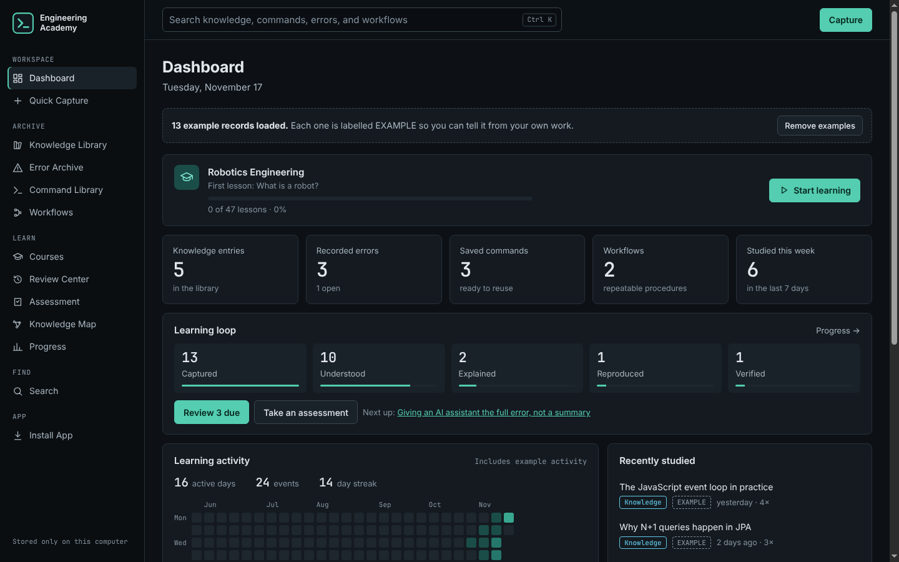

## Features

| Area | What it does |
| --- | --- |
| **Dashboard** | Totals for every collection, the five-stage learning-loop funnel, reviews due, a 26-week activity heatmap, recent captures and recently studied records |
| **Quick Capture** | One form for seven capture types, routed to the right collection. Warns before saving text that looks like a key, token, password or credential URL. |
| **Knowledge Library** | Concepts with *What is it / Why is it needed / How does it work / Real-world example / Practical exercise*, filterable by category, type, tag and text |
| **Error Archive** | Original error, root cause, investigation, solution, files affected, verification and lessons. Stays **Open** until a solution is written. |
| **Command Library** | Command, purpose, explanation, expected output, common mistakes, and one-click copy |
| **Workflows** | Repeatable implementation procedures: goal, prerequisites, ordered steps, verification, pitfalls |
| **Explain-back** | Prompts you to explain a record from memory while your notes stay hidden. Scores coverage of the key ideas in your notes and shows covered and missed terms side by side. |
| **Rebuild challenge** | Reproduce a command, code example, fix or set of steps. Scored by token-level similarity, with a line-by-line diff against the reference. |
| **Review Center** | Spaced repetition (SM-2 style) over your own notes, with keyboard controls (Space reveals, 1–4 rates) and a 7-day forecast |
| **Assessment** | Multiple-choice quizzes generated from your records (definitions, commands, error root causes, workflow goals), with weak and overdue material first. The answer key stays on the server until you submit. |
| **Knowledge Map** | Every record grouped by category, links drawn between them, learning stage shown as a ring, plus one-click *suggested connections* between records that share tags |
| **Progress** | Learning-loop funnel, mastery by category, explain/rebuild/assessment statistics, weekly practice chart, and a *work on next* list that links to the right next action |
| **Search** | Substring search across all four collections, including Korean text and literal `%` and `_` |
| **Courses** | Structured learning tracks: stages → modules → lessons, each lesson with learning objectives, explanations, key terms, a real-world example and a practice exercise, and a hands-on project at the end of every module. Progress, "continue where you left off" and an *Up next* marker. |
| **Lecture videos** | Every lesson has a video player. Attach a YouTube or Vimeo link (played inline through the privacy-enhanced embed) or an .mp4/.webm file, either by URL or from your own media folder. Native videos resume where you stopped and complete the lesson when they end. *Find lecture videos* searches YouTube for the lesson topic. |
| **Lesson → learning loop** | *Save to Knowledge Library* turns a lesson into a knowledge record (category **Robotics**), so explain-back, reviews and assessments work on course material too. |
| **Mobile and iPhone** | Phone layout with a bottom tab bar and a menu sheet, full-bleed 16:9 video, 44 px touch targets, no zoom-on-focus in Safari, and safe-area support for notched iPhones. |
| **Installable app (PWA)** | Web app manifest, service worker and Home Screen icons. Installs on iPhone, Android and desktop, opens full screen, and keeps the app shell and opened lessons available offline. *Install App* shows step-by-step instructions. |
| **Learning stage per record** | Every detail page shows its stage (Captured → Understood → Explained → Reproduced → Verified) and what unlocks the next one |

| Explain-back | Review Center |
| --- | --- |
| 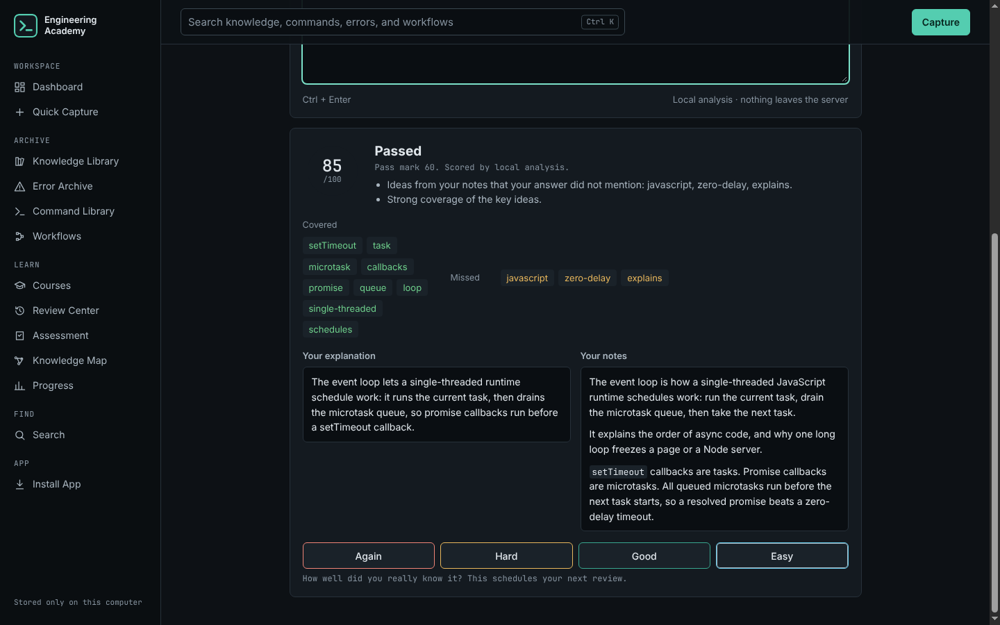 | 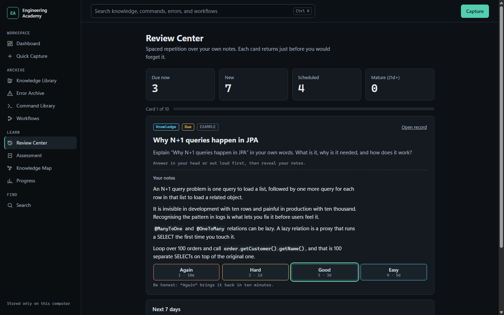 |
| **Knowledge Map** | **Progress** |
| 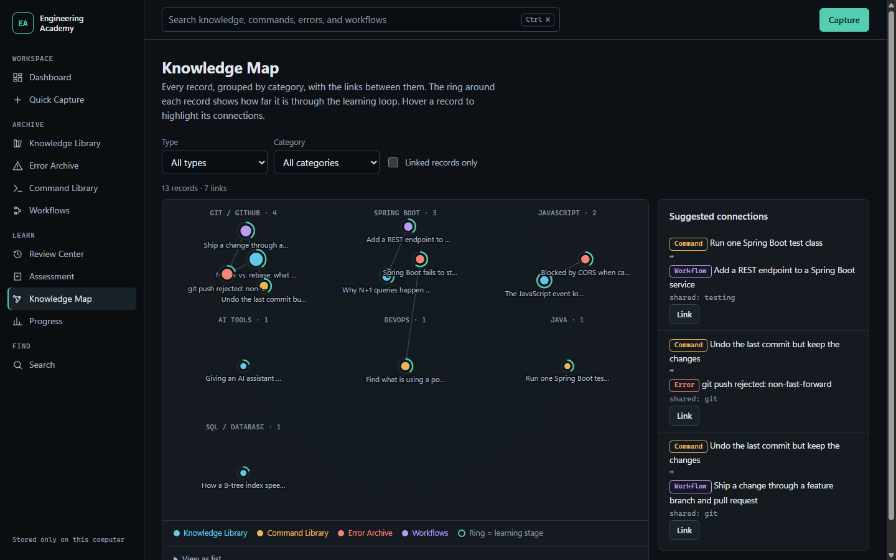 | 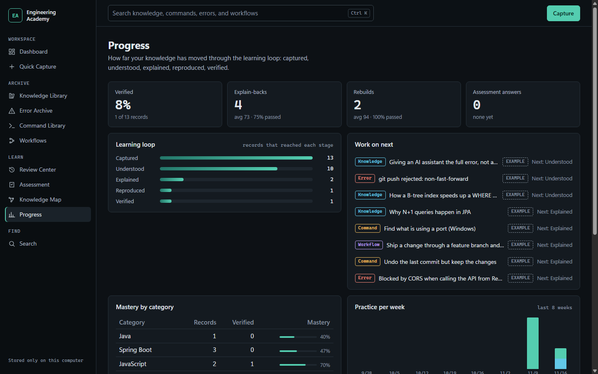 |
| **Assessment** | **Record detail with learning loop** |
| 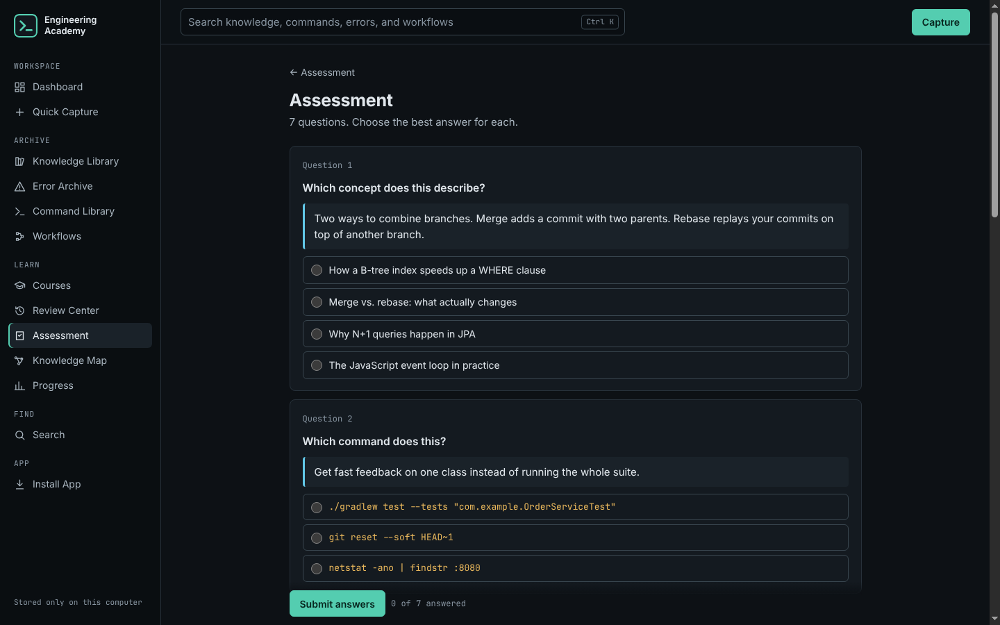 | 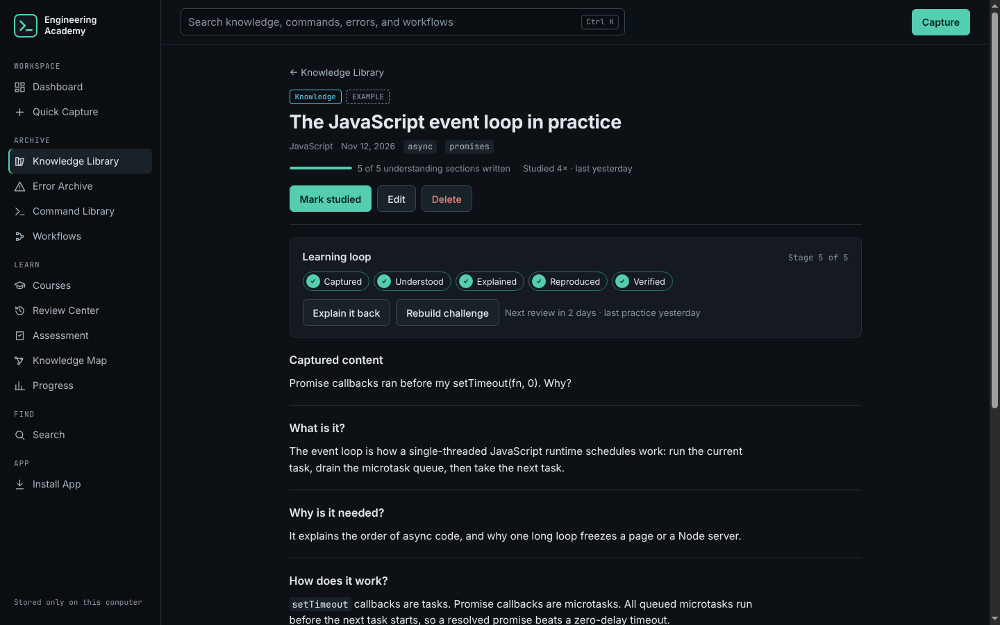 |

| **Course syllabus** | **Lesson with objectives and video** |
| --- | --- |
| 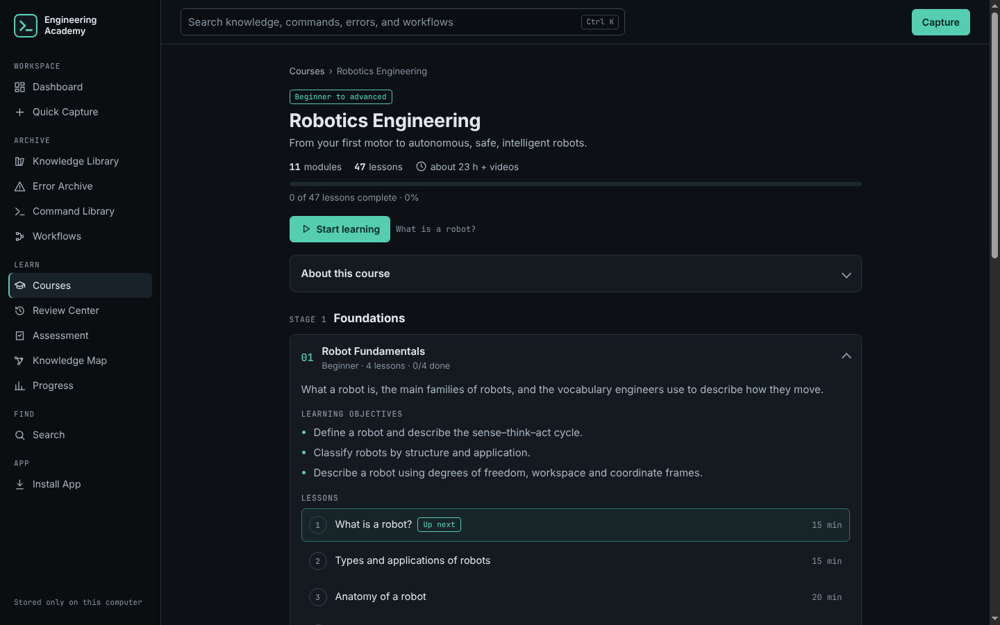 | 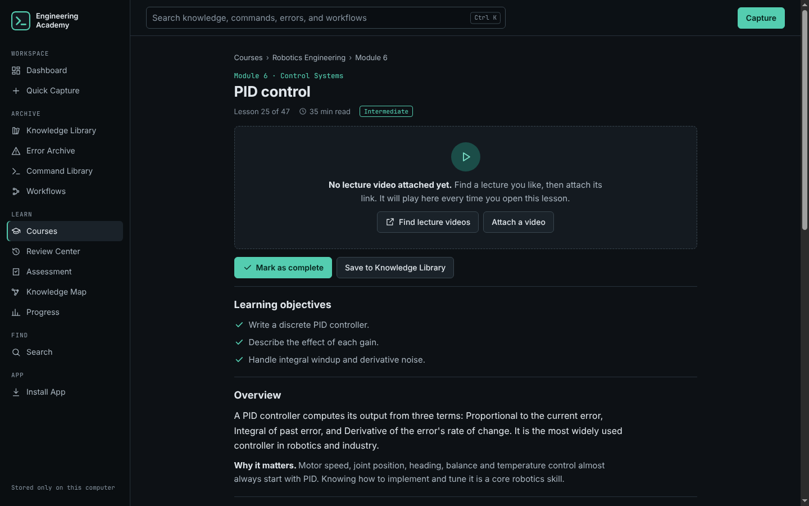 |

| iPhone: Dashboard | iPhone: Course | iPhone: Lesson | iPhone: Install |
| --- | --- | --- | --- |
| 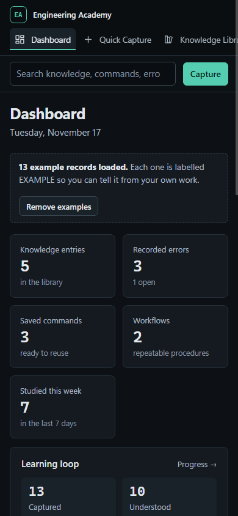 | 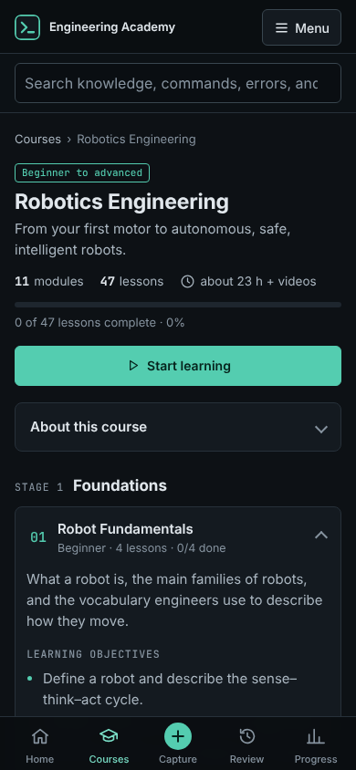 | 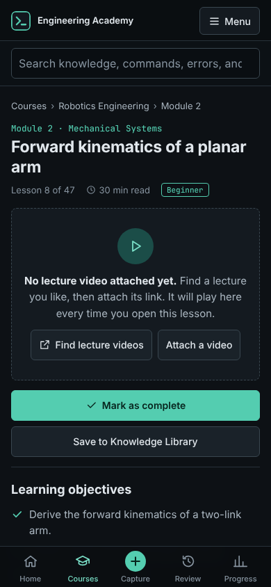 | 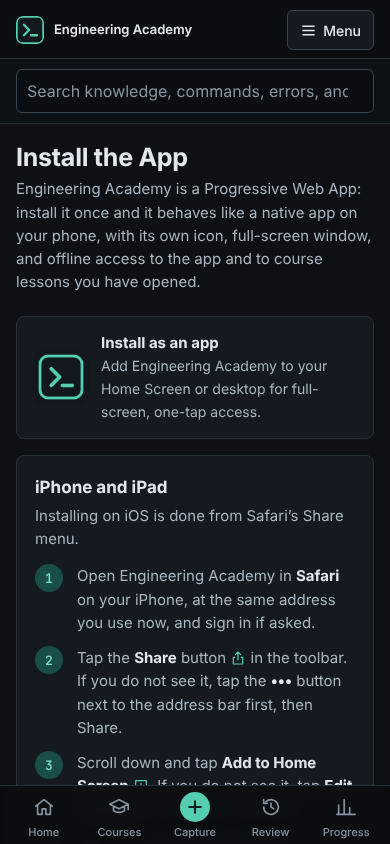 |

The screenshots come from `npm run screenshots`, which drives the real app against a fresh database containing only the built-in example records.

## Robotics Engineering course

Beginner-friendly, and it builds step by step towards real engineering projects. No prior programming is required; high-school algebra and basic trigonometry are enough to start. Each module ends with a hands-on project, and the final module is three capstone builds plus a portfolio.

| # | Module | Stage · level | Lessons | Module project |
| --- | --- | --- | --- | --- |
| 1 | Robot Fundamentals | Foundations · Beginner | What is a robot? · Types and applications of robots · Anatomy of a robot · Degrees of freedom, workspace and coordinate frames | Robot teardown report |
| 2 | Mechanical Systems | Foundations · Beginner | Links, joints and kinematic chains · Actuators: DC, servo and stepper motors · Gears, transmissions and torque · Forward kinematics of a planar arm · End effectors, materials and structure | Two-link arm calculator and model |
| 3 | Electronics for Robotics | Foundations · Beginner | Voltage, current, resistance and power · Microcontrollers: GPIO, PWM and ADC · Motor drivers and H-bridges · Batteries and power distribution | Motor control test bench |
| 4 | Sensors and Perception | Core skills · Intermediate | Sensor fundamentals: accuracy, precision and noise · Encoders and IMUs · Distance sensing: ultrasonic, infrared and LiDAR · Cameras and computer vision basics · Filtering and sensor fusion | Obstacle-aware sensor head |
| 5 | Robot Programming | Core skills · Intermediate | Robot software architecture and control loops · Embedded programming in C++ (Arduino) · Python for robotics · ROS 2: nodes, topics, services and actions · Simulation and digital twins | Teleoperated rover with telemetry |
| 6 | Control Systems | Core skills · Intermediate | Open-loop and closed-loop control · PID control · Tuning controllers in practice · Differential-drive kinematics and odometry | Precise driving challenge |
| 7 | Artificial Intelligence for Robotics | Advanced | Machine learning for robots · Deep learning for robot perception · Reinforcement and imitation learning · Foundation models and edge AI | Vision-guided robot behaviour |
| 8 | Autonomous Systems | Advanced | Localization · Mapping and SLAM · Path planning: A*, Dijkstra and RRT · Navigation and obstacle avoidance · Decision-making with behaviour trees | Autonomous navigation in simulation |
| 9 | Human-Robot Interaction | Advanced | Foundations of human-robot interaction · Collaborative robots (cobots) · Trust, transparency and ethics | Interaction design for a shared-space robot |
| 10 | Robot Safety Engineering | Advanced | Hazards and risk assessment · Safety standards for robots · Emergency stops, safeguarding and safe states · Electrical, battery and software safety | Safety case for your robot |
| 11 | Capstone Engineering Projects | Capstone · Project | The robotics engineering process · Project 1: Smart line-following robot · Project 2: Autonomous ROS 2 rover · Project 3: Vision-guided pick-and-place arm | Engineering portfolio |

Every lesson contains: a summary, *why it matters*, three learning objectives, two or three explanation sections, key terms with definitions, a real-world example, a practice exercise and a lecture video slot. Total reading time is about 23 hours, plus videos and projects.

The curriculum lives in `server/curriculum/robotics.js`. Your progress, attached videos and saved notes live in the database, keyed by lesson id, so improving the text never loses progress. Add another track by creating a file next to it and listing it in `TRACKS` in `server/courses.js`.

### Lecture videos

The app ships no video files and links to no specific videos: links to third-party videos go stale, and you should choose lectures you like. On each lesson:

- **Find lecture videos** opens a YouTube search for that lesson's topic (in the YouTube app on iPhone).
- **Attach a video** accepts a YouTube link (`watch`, `youtu.be`, `shorts`, playlists, `t=` start times), a Vimeo link, or a direct https link to an .mp4/.webm/.mov file. YouTube plays inline through `youtube-nocookie.com`.
- To host your own lectures, put .mp4 (H.264), .m4v, .webm or .mov files in `data/videos/` (or `ACADEMY_MEDIA_DIR`) and pick them from the list in the attach form. They are served with HTTP range requests, which iPhone Safari needs for playback and seeking, and they require sign-in when a password is set.

## Use it on your iPhone

The recommended setup is a permanent cloud deployment on Cloudflare's free plan: static files from the nearest edge, the API and SQLite database in a Durable Object, HTTPS, no sleeping server and no cost. Your computer does not need to be on. See [docs/DEPLOY.md](docs/DEPLOY.md). The options below are for running it from your own computer instead.

The app runs on your computer, so your phone needs a way to reach it, and that computer must be on and running `npm run start:public`. For "any time, anywhere" access, use an always-on computer or a small server. Installing as an app and offline support need **https**.

### Option A (recommended): Tailscale, private and works anywhere

[Tailscale](https://tailscale.com) is free for personal use. It gives your computer a fixed https address that only your own devices can reach.

1. Install Tailscale on the computer and on your iPhone, and sign in to the same account on both.
2. On the computer, run `tailscale serve --bg 4310`. It prints an address like `https://my-pc.tail1234.ts.net`. If it asks you to, enable **HTTPS certificates** (and MagicDNS) in the Tailscale admin console first.
3. Create `.env` (copy `.env.example`) with:

   ```dotenv
   ACADEMY_ALLOWED_HOSTS=my-pc.tail1234.ts.net
   ACADEMY_PASSWORD=choose-a-long-password
   ACADEMY_SESSION_SECRET=any-long-random-text
   ACADEMY_SECURE_COOKIES=true
   ```

4. Run `npm run start:public`, then open the https address in Safari on the iPhone with Tailscale switched on.

A Cloudflare Tunnel works too (`ACADEMY_ALLOWED_HOSTS=*.trycloudflare.com` plus `ACADEMY_TRUST_PROXY=true`), but a quick tunnel gets a new address each time it starts, and an installed app is tied to one address, so use a named tunnel with your own domain for a permanent install.

### Option B: home Wi-Fi only

Set `HOST=0.0.0.0`, `ACADEMY_ALLOWED_HOSTS=<your computer's LAN IP, e.g. 192.168.1.20>` and `ACADEMY_PASSWORD` in `.env`, run `npm run start:public`, and open `http://192.168.1.20:4310` on the iPhone. Everything works and Add to Home Screen still opens it full screen, but without https there is no service worker, so no offline access.

### Install on the iPhone Home Screen

1. Open the app's address in **Safari** and sign in.
2. Tap **Share** (the square with an arrow). If you do not see it, tap **•••** next to the address bar first.
3. Tap **Add to Home Screen**. If it is missing, tap **Edit Actions** and add it.
4. If shown, keep **Open as Web App** switched on. The name is **Eng Academy**. Tap **Add**.
5. Open **Eng Academy** from the Home Screen. It starts full screen with the Engineering Academy icon. Sign in once inside the app (it keeps its own sign-in, valid for 30 days).

The same steps are in the app under **Install App**. The icon is fixed; see [docs/BRANDING.md](docs/BRANDING.md).

### How a record moves through the loop

| Stage | Reached when |
| --- | --- |
| Captured | The record exists |
| Understood | Its core explanation fields are written (for example *What / Why / How* for knowledge, *Root cause* and *Solution* for errors) |
| Explained | An explain-back attempt scores **60** or more |
| Reproduced | A rebuild attempt scores **80** or more. This step is skipped for records with nothing to rebuild. |
| Verified | Answered correctly in an assessment, or recalled successfully in two reviews |

Exercises are locked until the notes they are checked against exist, and the app tells you what to write first. Your own notes are always the answer key.

## AI-ready, not AI-dependent

Answers are scored by `server/evaluator.js`. The default provider, `local`, is deterministic and runs on the server. It uses key-term coverage with light stemming and Korean support for explanations, and token-level LCS similarity for rebuilds. No text leaves the machine.

An AI provider can be added later without touching the rest of the app:

1. Implement `explain({ reference, response, record, kind })` and `rebuild(...)` returning `{ score, feedback, ... }`.
2. Register it in `PROVIDERS` in `server/evaluator.js`.
3. Select it with `ACADEMY_EVALUATOR=<name>`.

The provider receives only one answer and one record's reference text. See [docs/ROADMAP.md](docs/ROADMAP.md) for the privacy requirements that must be met first.

## Architecture

```text
Browser (vanilla ES modules, hash router)
   │  fetch JSON
   ▼
server/app.js ─── request guards (Host allow-list, Origin check, JSON-only writes, 2 MB cap)
   │               optional password session (server/auth.js)
   ├── server/repository.js  records: validation, CRUD, search, links, dashboard
   ├── server/learning.js    exercises, review scheduling, assessments, map, progress
   │      └── server/evaluator.js  pluggable answer scoring (local by default)
   ├── server/courses.js     course tracks, lesson progress, lecture videos
   │      └── server/curriculum/  course content (Robotics Engineering)
   ▼
server/db.js ─── node:sqlite, versioned migrations (PRAGMA user_version)
   ▼
data/academy.db (one file)
```

```text
server/
  index.js        Configuration from environment, startup safety checks
  app.js          HTTP routes, static files, security headers and guards
  auth.js         Optional password sign-in: signed HttpOnly cookie, rate limiting
  db.js           SQLite connection and append-only migrations
  repository.js   Record validation, queries, search
  learning.js     Learning loop: stages, practice, reviews, assessments, map, progress
  evaluator.js    Answer scoring providers
  courses.js      Courses: syllabus, lesson progress, video links, save-to-library
  curriculum/     Course content, one file per track (robotics.js)
  resources.js    Categories, capture types, field definitions
  seed.js         First-run EXAMPLE records and practice history
public/
  index.html      Application shell (PWA meta tags, icons, tab bar)
  manifest.webmanifest  Installable-app manifest
  sw.js           Service worker: offline app shell and opened lessons
  favicon.svg     The app icon master artwork (see docs/BRANDING.md)
  icons/          Home Screen and manifest icons rendered from favicon.svg
  css/            styles.css (design tokens, layout), learning.css, courses.css (courses, video, mobile shell)
  js/main.js      Router, navigation, sign-in handling
  js/api.js       Fetch wrapper
  js/dom.js       Safe DOM builder (text nodes only, never innerHTML)
  js/schema.js    How each record type is displayed and edited
  js/video.js     Lecture video player (YouTube, Vimeo, native video)
  js/pwa.js       Service worker registration, install prompt, iOS detection
  js/views/       One module per screen
scripts/          Build check, screenshot generator, icon renderer
tests/            API, learning and security tests, plus browser end-to-end tests
```

## Technology stack

| Layer | Choice |
| --- | --- |
| Runtime | Node.js ≥ 22.13 (developed on Node 26) |
| HTTP | `node:http` with a small hand-written router |
| Database | SQLite via the built-in `node:sqlite` module |
| Frontend | Vanilla JavaScript ES modules, HTML and CSS. No framework, no bundler. |
| Tests | `node:test` for API tests; a dependency-free Chrome DevTools Protocol driver for browser tests |

## Installation and local use

Requires **Node.js 22.13 or newer**. There is nothing to install beyond cloning.

```powershell
git clone <repository-url> engineering-academy
cd engineering-academy
npm start
```

Open <http://localhost:4310>. The first run adds 13 records labelled **EXAMPLE**, with some practice history so the learning pages are not empty. Remove them with one button on the Dashboard; they never come back.

| Command | Purpose |
| --- | --- |
| `npm start` | Run on `127.0.0.1:4310` (local only, no password) |
| `npm run dev` | Run and restart when server files change |
| `npm run start:public` | Run with settings from `.env` (see below) |
| `npm run build` | Check every JavaScript file parses and every import and asset resolves |
| `npm test` | API, learning, security and migration tests against temporary databases |
| `npm run test:e2e` | Browser tests in headless Chrome or Edge (set `CHROME_PATH` if not found) |
| `npm run screenshots` | Regenerate `docs/screenshots/` |
| `npm run cloud:dev` | Run the Cloudflare version locally (`.dev.vars` holds test secrets) |
| `npm run cloud:deploy` | Deploy to Cloudflare (see docs/DEPLOY.md) |
| `npm run cloud:smoke -- <url> <password>` | Check a deployment: assets, sign-in, API, courses, PWA files |
| `npm run icons` | Re-render the app icons from `public/favicon.svg` (only after an approved icon change) |

Keyboard: `Ctrl K` search, `Ctrl Enter` save or check an answer, `Space` and `1`–`4` in the Review Center.

## Environment configuration

All settings are optional environment variables. [`.env.example`](.env.example) documents each one. Copy it to `.env`, which Git ignores, and run `npm run start:public`.

| Variable | Default | Purpose |
| --- | --- | --- |
| `PORT` | `4310` | Port |
| `ACADEMY_DB` | `data/academy.db` | SQLite file |
| `HOST` | `127.0.0.1` | Interface to bind |
| `ACADEMY_PASSWORD` | none | Turns on sign-in. **Required (12+ characters)** whenever `HOST` or `ACADEMY_ALLOWED_HOSTS` exposes the app; the server refuses to start otherwise. |
| `ACADEMY_ALLOWED_HOSTS` | none | Extra `Host` values to accept, for example `*.trycloudflare.com` |
| `ACADEMY_SESSION_SECRET` | random per start | Keeps sign-ins valid across restarts |
| `ACADEMY_TRUST_PROXY` | `false` | Trust `X-Forwarded-Proto` and `CF-Connecting-IP` from a tunnel or proxy |
| `ACADEMY_SECURE_COOKIES` | `false` | Always mark the session cookie `Secure` |
| `ACADEMY_SEED` | `true` | Add example records to a new database |
| `ACADEMY_EVALUATOR` | `local` | Answer-scoring provider |
| `ACADEMY_MEDIA_DIR` | `data/videos` | Folder of lecture videos you host yourself, served at `/media/` |

## Database structure

One SQLite file. Migrations in `server/db.js` are append-only and tracked with `PRAGMA user_version`. An existing v1 database from the MVP upgrades in place with no data loss, and a test covers this.

| Table | Contents |
| --- | --- |
| `knowledge` | Concepts: content, capture type, what / why / how, real example, exercise |
| `commands` | Command, purpose, explanation, expected output, common mistakes |
| `errors` | Error message, root cause, investigation, solution, files affected, verification, lessons |
| `workflows` | Goal, prerequisites, steps, verification, pitfalls |
| `links` | Undirected links between any two records (stored once, smaller reference first) |
| `attempts` | Every explain-back, rebuild, assessment answer and review: mode, score, rating, time |
| `reviews` | Spaced-repetition state per record: due date, interval, ease, repetitions, lapses |
| `quizzes` | Generated assessments, with the answer key, submitted answers and score |
| `activity` | Event log behind the heatmap (created, updated, studied, deleted) |
| `meta` | Internal flags, for example whether examples were seeded |
| `lesson_progress` | Per lesson: completed time, attached video link, video position, and the Knowledge Library record it was saved as |

All record tables share `title`, `category`, `tags` (JSON array), `entry_date`, `is_sample`, `created_at`, `updated_at`, `last_studied_at` and `study_count`. Deleting a record also deletes its links, attempts and review schedule.

**Your data:** `data/` is excluded from Git. To back up, stop the server and copy `data/academy.db`. To reset, stop the server and delete it.

## Tests

```powershell
npm run build      # static check
npm test           # 85 API, learning, course, video, PWA, branding, deployment, security and migration tests
npm run test:e2e   # 40 browser checks in headless Chrome or Edge
```

The tests cover CRUD for all four collections, capture routing, validation and error responses, search (substring, Korean, wildcards, SQL metacharacters), links, persistence across restarts, the v1 to v2 migration, explain and rebuild scoring, review scheduling, assessment generation and grading (including that the answer key is never sent early), the knowledge map and link suggestions, sign-in (cookie flags, tampering, rate limiting), the host allow-list, the refusal to start exposed without a password, XSS rendering, CSP violations, and layout overflow from 390 px to 1440 px.

Courses and mobile: curriculum completeness and ordering, lesson completion and progress, video link validation (unsafe links rejected), byte-range video serving and path traversal, saving lessons to the library, actual playback of a recorded video from the media folder, YouTube embed URLs, the phone tab bar and menu, the full-bleed 16:9 player at iPhone width, the manifest, icons and service-worker registration, and a hash lock on every icon file.

When running as root (Linux containers, CI) the browser tests start Chrome with `--no-sandbox` automatically.

## Security

- By default the server listens on `127.0.0.1` only, with no password.
- Exposing it (`HOST` other than loopback, or any `ACADEMY_ALLOWED_HOSTS`) requires `ACADEMY_PASSWORD`, otherwise the server refuses to start.
- Sessions are HMAC-signed, `HttpOnly`, `SameSite=Strict` cookies (also `Secure` behind HTTPS). Failed sign-ins are rate-limited per client.
- Requests with an unexpected `Host` are rejected, which blocks DNS rebinding. Writes from a foreign `Origin` are rejected, which blocks CSRF.
- All captured text is rendered as text nodes, backed by a strict Content-Security-Policy. The policy allows exactly two outside frame sources, `www.youtube-nocookie.com` and `player.vimeo.com`, for lecture videos, and https video files. Scripts still load only from the app itself.
- Lecture video links must be https or a file in the media folder; `javascript:`, `data:` and plain http links are refused. Media files are served only from the media folder, only with video extensions, and only to signed-in users.
- The service worker never caches your records, reviews or videos, only the app's own files and course pages.
- Secrets in `.env`, `*.pem` and `*.key` files, and the `data/` directory, are excluded from Git.

## Roadmap

See [docs/ROADMAP.md](docs/ROADMAP.md): Claude Code hooks integration, automatic capture with a review inbox, AI explanation drafts, and the privacy rules that must hold before any of it ships.
